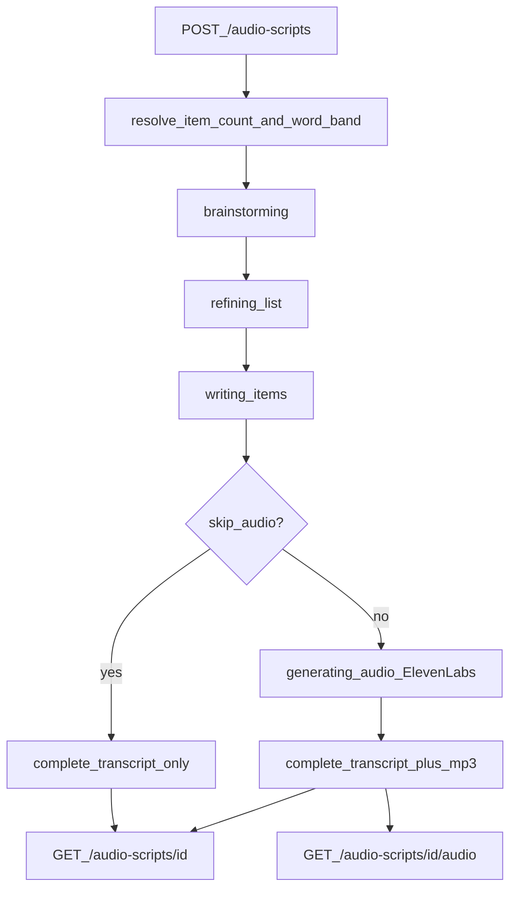

# Audio Script Flow

How a title becomes a transcript + MP3. Companion to
[AUDIO_SCRIPT_PIPELINE.md](./AUDIO_SCRIPT_PIPELINE.md) (API/ops reference).

## End-to-end flow



## Request knobs (plain language)

| Field | What it does |
|-------|----------------|
| `title` | Theme for the narration. If it says “100 ways…”, the default is **100 items**. If it says “3 Hours of…” / “45 Minutes of…”, the script is sized for that **listening time** (~130 words/minute) instead of treating the number as an item count. |
| `category` | Free-text niche for prompt voice (e.g. `psychology`, `true crime`). Known niches get richer domain phrasing; anything else is used as-is. |
| `item_limit` | Exact item/section count when set (API-only; not shown on the create form). Omit → count from the title’s promised number, or a duration-derived count when the title is time-based. |
| `word_count` | Target words **per paragraph/section** (API-only; not on the create form). Omit → SOP **265–270**, or derived from `overall_word_limit` / title duration. Allowed range: **100–500**. |
| `overall_word_limit` | Cap for the **whole transcript**. UI: **Total transcript words**. Per-section length is derived automatically as `overall ÷ section count` (clamped 100–500). When omitted, duration titles derive `minutes × 130`. Allowed range: **100–150000**. |
| `skip_audio` | Transcript only (no ElevenLabs / no MP3). |
| `voice_id` / `model_id` / `voice_settings` | Optional TTS overrides (defaults documented in the pipeline doc). |

### `item_limit` example

Title: `100 Ways to Do Something` + `item_limit: 2` → **2 items** written and narrated.
Title: `3 Hours of …` + `item_limit: 10` → **10 items** (explicit limit overrides the “3” in the title).
The stored title text is unchanged.

### `word_count` / `overall_word_limit` example

- Omitted → each item prompted and rewrite-checked for **265–270** words.
- `"word_count": 200` → each item targeted at **200** words (accept band **195–205**).
- `"overall_word_limit": 3000` + 10 items → each item targeted at **300** words.
- Both set with `word_count × items` over overall → per-item target clamped to `overall ÷ items`.

### Duration title example

Title: `3 Hours of Emotional Control Secrets…` (no `item_limit` / `overall_word_limit`):

- Parses **180 minutes** (not “3 items”).
- Overall budget ≈ `180 × 130` = **23,400** words.
- Item count ≈ `23400 / 267` ≈ **88** items at SOP density.
- Per-item target ≈ **265** words → ~3 hours of narration at 130 wpm.

Title: `100 Secrets for 3 Hours of Deep Focus` → keeps **100** items and still applies the 3-hour word budget (~234 words/item).

## Stages

| Stage | What happens |
|-------|----------------|
| `queued` | Job accepted |
| `brainstorming` | LLM lists N concept titles (sentence case) |
| `refining_list` | List sharpened for retention |
| `writing_items` | Each item written conversationally to the word band (rewrite if out of band) |
| `generating_audio` | Per-item ElevenLabs TTS → ffmpeg concat → one MP3 |
| `complete` | Done |

Progress `done` / `total` uses the resolved item count as `total`.

## Artifacts

```
artifacts/audio-scripts/{script_id}/
  request.json    # original POST body (includes word_count when set)
  status.json     # stage + progress
  result.json     # transcript, items[].word_count, total_words
  narration.mp3   # present unless skip_audio
```

## Example curl

```bash
curl -X POST http://localhost:8010/audio-scripts \
  -H 'content-type: application/json' \
  -d '{
    "title": "100 Concepts That Make You See the World Differently Than 99% of People",
    "category": "psychology",
    "item_limit": 3,
    "word_count": 270,
    "overall_word_limit": null,
    "skip_audio": false
  }'

curl -s http://localhost:8010/audio-scripts/SCRIPT_ID
curl -o narration.mp3 http://localhost:8010/audio-scripts/SCRIPT_ID/audio
```

When status is `done`, the GET body includes `transcript`, `items` (each with `word_count`), `total_words`, and `audio_link` (unless `skip_audio`).
