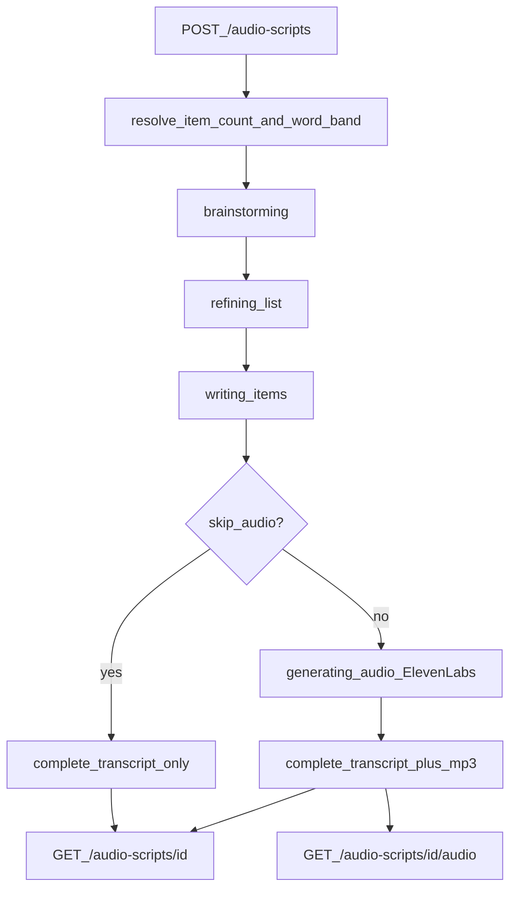

# Audio Script Flow

How a title becomes a transcript + MP3. Companion to
[AUDIO_SCRIPT_PIPELINE.md](./AUDIO_SCRIPT_PIPELINE.md) (API/ops reference).

## End-to-end flow



## Request knobs (plain language)

| Field | What it does |
|-------|----------------|
| `title` | Theme for the narration. If it says “100 ways…”, the default is **100 items**. |
| `item_limit` | Exact item count when set (capped by max). Omit → count from the title’s promised number (e.g. “100 ways…” → 100). Title text is **not** rewritten. |
| `word_count` | Target words **per item**. Omit → SOP **265–270**. Set e.g. `200` → band **195–205** (±5). Allowed range: **100–500**. |
| `skip_audio` | Transcript only (no ElevenLabs / no MP3). |
| `voice_id` / `model_id` / `voice_settings` | Optional TTS overrides (defaults documented in the pipeline doc). |

### `item_limit` example

Title: `100 Ways to Do Something` + `item_limit: 2` → **2 items** written and narrated.
Title: `3 Hours of …` + `item_limit: 10` → **10 items** (explicit limit overrides the “3” in the title).
The stored title text is unchanged.

### `word_count` example

- Omitted → each item prompted and rewrite-checked for **265–270** words.
- `"word_count": 200` → each item targeted at **200** words (accept band **195–205**).

## Stages

| Stage | What happens |
|-------|----------------|
| `queued` | Job accepted |
| `brainstorming` | LLM lists N concept titles (sentence case) |
| `refining_list` | List sharpened for retention |
| `writing_items` | Each item written conversationally to the word band (rewrite if out of band) |
| `generating_audio` | Per-item ElevenLabs TTS → ffmpeg concat → one MP3 |
| `complete` | Done |

Progress `done` / `total` uses the resolved item count as `total`.

## Artifacts

```
artifacts/audio-scripts/{script_id}/
  request.json    # original POST body (includes word_count when set)
  status.json     # stage + progress
  result.json     # transcript, items[].word_count, total_words
  narration.mp3   # present unless skip_audio
```

## Example curl

```bash
curl -X POST http://localhost:8010/audio-scripts \
  -H 'content-type: application/json' \
  -d '{
    "title": "100 Concepts That Make You See the World Differently Than 99% of People",
    "item_limit": 3,
    "word_count": 270,
    "skip_audio": false
  }'

curl -s http://localhost:8010/audio-scripts/SCRIPT_ID
curl -o narration.mp3 http://localhost:8010/audio-scripts/SCRIPT_ID/audio
```

When status is `done`, the GET body includes `transcript`, `items` (each with `word_count`), `total_words`, and `audio_link` (unless `skip_audio`).
